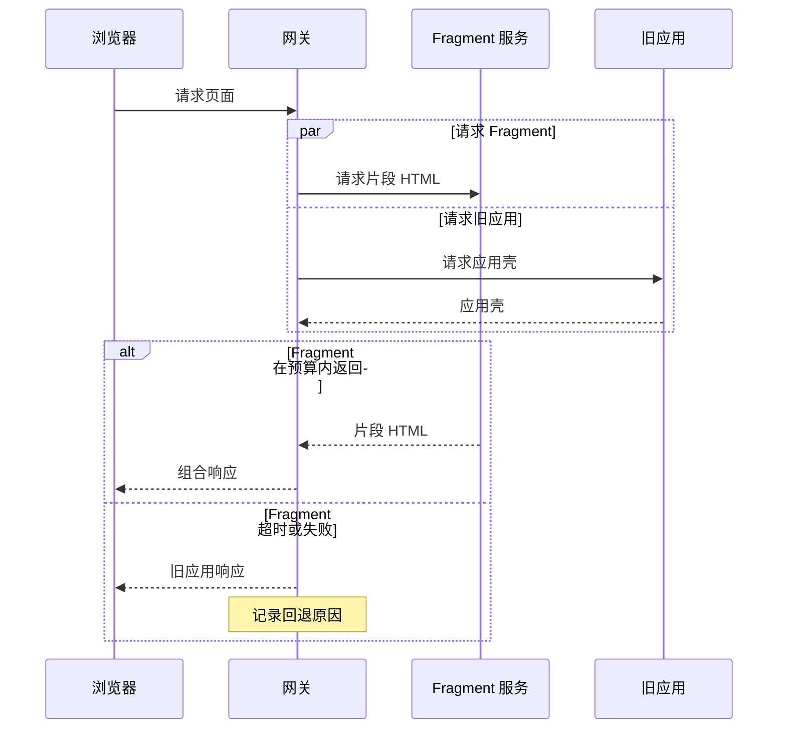

# RFC 视觉与动态演示

在决定画什么前，先明确读者需要理解的关系或变化，以及图会增加哪条可用于判断的信息。没有信息增益时用短段落、代码或表格即可；对于多方协作和动态过程，应主动制作适当的图示。

## 选型

| 需要理解的内容 | 优先表达 | 图中需要的信息 |
| --- | --- | --- |
| 模块职责与系统边界 | 架构图／组件图 | 参与方、边界、方向、接口或数据；区分现有与新增。 |
| 请求、异步协作、并发与错误恢复 | 时序图 | 参与方、触发条件、关键先后关系、并行区间、失败分支。 |
| 生命周期、资源归属与合法状态迁移 | 状态图 | 状态、事件或条件、终止与恢复路径；必要时标出不变量。 |
| API、配置、界面或迁移前后差异 | 相同输入的对照代码／截图／差异表 | 保持环境一致，突出发生变化的部分。 |
| 方案取舍、兼容性与支持范围 | 对照表／矩阵 | 统一比较标准；区分事实、判断和未知。 |
| 延迟、吞吐、资源或规模关系 | 数据图表 | 来源、条件、单位、轴、统计口径；按数据情况呈现分布或不确定性。 |
| 交互反馈、渲染变化、并发体验 | GIF／视频／关键帧 | 同一任务的起止状态、关键操作、等待与反馈、演示条件。 |

避免把一张图塞成整个系统的地图。按需要分为总览与局部详图，保持参与方名称一致。每张图通常聚焦一个主要问题，不规定图数、颜色数或页数。

## 制作与图注

- 简洁的结构与时序优先 Mermaid；需要精确布局时使用可编辑矢量源。数据图使用可复现的绘图脚本和真实数据。工具选择服从目标文档平台与现有环境。
- **本地默认风格：** 技术图采用白底、细线、克制的颜色与简洁图标，接近基础设计稿的线条表达。时序图优先使用横向参与方、虚线生命线、细箭头和清楚的活动条，参考用户偏好的 [Cloudflare Fragment Piercing 配图](https://blog.cloudflare.com/fragment-piercing/#how-it-works)。按信息结构调整，不强制所有图采用同一布局；用户后续指定的风格优先。
- 精确架构、协议、代码、日志和基准图不交给生成式图片工具自由编造。概念插图或 UI mockup 容易被误认为实际界面或已实现行为时，应标明其类型，不能充当实际行为的证据。
- 图注只写有助于理解的结论或必要条件，不逐项复述图中内容，不机械附加状态、非实测声明或维护说明。省略内容会影响读者判断时才说明。图源文件随文档保存，默认不在正文、图注或附录列出编辑、生成路径和图源链接。实际证据仍在相关结论旁引用。
- 用标签、线型或形状表达含义，颜色作辅助。字号在最终阅读尺寸下可辨认；提供简短替代文本。截图去除无关界面并标记焦点，不隐藏影响判断的信息。
- 正文解释原因和例外，图呈现结构或变化；避免将图中每一个节点重新写一遍。

## 示例：把异常分支纳入时序

以下仅示范表达方式，不预设实际项目应采用这个回退策略。写真实 RFC 时，应根据实际接口约定和运行要求确定超时预算、响应状态和副作用，不从示例照抄设计。

示意图表达的是“片段失败时退回旧应用”的设计分支；未覆盖旧应用自身失败和已经开始流式输出的情况。真实 RFC 必须根据范围补齐这些行为，不能用此图证明回退方案已经完整。

## GIF 与视频

当时间和动作本身影响理解时制作动态演示，例如焦点是否保留、界面何时可交互、并发期间内容如何变化。纯模块关系或静态 API 差异通常不需要动画。

1. **确定演示命题。** 明确输入、操作、起止状态，以及观众应看出的差异。比较方案时保持数据、设备、网络和操作可比。
2. **选择证据类型。** 有真实实现与可用环境时录制；只有设计时制作概念动画、原型或分镜，在可能被误认为实际录制时标明类型。动画不能证明已经实现、性能提升或不存在故障。
3. **准备短分镜。** 记录关键操作、状态变化、需要展示的时间或指标；只保留解释命题的片段。GIF 适合简短循环，较长过程使用可暂停视频；时间不是论点时可用分步静态图。
4. **制作并核对。** 使用当前可用的录屏、浏览器或动画工具。涉及真实服务的录制使用已授权的测试数据与操作，不为演示擅自触发业务写入。标明加速、剪辑或模拟延时，不能剪掉与结论有关的等待、错误或重试。
5. **提供静态回退。** 附关键帧、静态时序或简短操作说明；关键结论不依赖播放、声音或观看外链视频才能获得。
6. **交付可维护材料。** 根据需要保留录制条件、输入或脚本、媒体文件、封面／关键帧及嵌入路径。没有生成媒体时交付分镜或步骤，明确“未录制”，不嵌入不存在的文件。

## 渲染与交付检查

- 在目标平台或可用渲染器中查看实际结果；Mermaid 源码、SVG 源码存在不等于已检查视觉效果。
- 检查箭头方向、分支、标签对应关系、重叠、裁切、文字大小和对比度；播放动态媒体，核对关键帧、顺序、字幕和循环衔接。
- 目标平台不支持 Mermaid／SVG 时，在工具允许下导出 PNG 等兼容格式，同时保留源文件；不能导出时保留文字或表格表达并说明限制。
- 随文档保存资源。展示所用的图片和媒体使用目标平台支持的相对路径或附件引用，链接必须指向真实生成且可访问的文件。生成脚本和可编辑源文件作为交付资源保留，不因保留文件而在成稿中附加维护入口。
- 如果无法渲染或播放，明确列出未验证的项目；不要把源码审阅描述为视觉验证通过。
